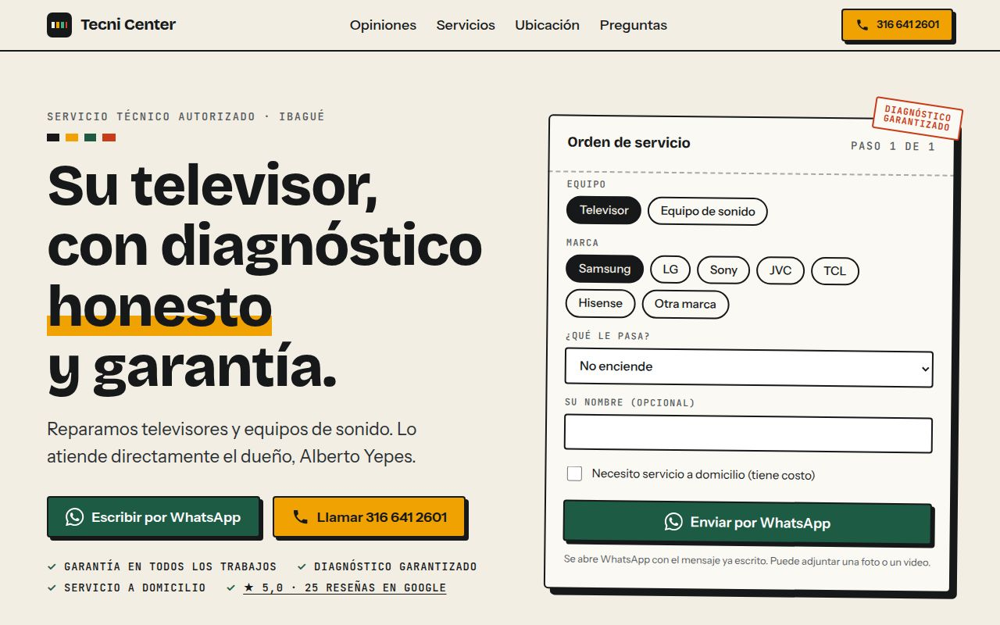
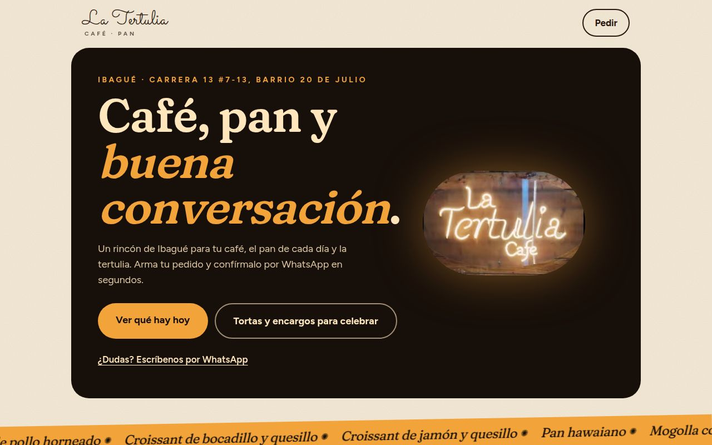

<p align="center">
  
</p>

# Hola, soy Jean Cardozo · JeanCRG

Desarrollador full-stack en Ibagué, Colombia. Diseño y programo **sitios web con SEO local, tiendas en línea, asistentes de WhatsApp con IA y software a la medida** para negocios que quieren que los encuentren en Google y los atiendan por WhatsApp.

Este repositorio es el código de mi portafolio: **https://jeancrg.netlify.app**. Está publicado para que puedas revisar cómo trabajo antes de contratarme.

[](https://github.com/JeanCardozo/Portafolio/actions/workflows/ci.yml)
[](https://github.com/JeanCardozo/Portafolio/actions/workflows/codeql.yml)

**Contacto:** [WhatsApp +57 301 622 7477](https://wa.me/573016227477) · [jean.cardozo.ramirez.23@gmail.com](mailto:jean.cardozo.ramirez.23@gmail.com) · [LinkedIn](https://www.linkedin.com/in/jeancardozo/) · [YouTube](https://www.youtube.com/@JEANCRG)

## Qué puedo hacer por tu negocio

| Servicio | Para qué sirve | Desde (USD) |
|---|---|---|
| Sitio web | Que te encuentren en Google y lleguen a tu WhatsApp | 280 |
| Tienda en línea | Catálogo, carrito, domicilio con mapa y pago en línea | 1.300 |
| Asistente de WhatsApp con IA | Responde, toma datos y pasa a una persona cuando hace falta | 450 |
| Software a la medida | Aplicaciones web o móviles, paneles de administración e integraciones | 3.000 |

Los precios son de referencia y están en dólares; el precio final es cerrado y por escrito. Puedes calcular el tuyo en el [cotizador del sitio](https://jeancrg.netlify.app/#cotizador).

## Trabajo real

| Tecni Center · taller de TV, Ibagué | La Tertulia Café · panadería, Ibagué |
|---|---|
| [](https://tecnicenter.netlify.app) | [](https://la-tertulia-cafe.vercel.app) |
| Astro, SEO local, datos estructurados, orden de servicio que escribe el mensaje de WhatsApp. [Sitio](https://tecnicenter.netlify.app) · [Código](https://github.com/JeanCardozo/TecniCenter) | Next.js, Supabase, carrito, domicilio con mapa y panel de administración con RLS. [Sitio](https://la-tertulia-cafe.vercel.app) |

Entre los dos sitios llegaron más de 50 clientes nuevos en las primeras semanas de operación digital (cifra verificada por mí; los dueños autorizaron mostrar ambos casos).

También en desarrollo: **Fresko**, una plataforma móvil y web para propiedad horizontal (React Native, Expo, Supabase). Y **chatAI**, un sistema de asistentes de WhatsApp con IA: demo en vivo bajo solicitud.

## Más código público

- [ComponenteVelada](https://github.com/JeanCardozo/ComponenteVelada): Astro 6, React 19 y TypeScript estricto; sitio estático con cero JavaScript en producción.
- [scraper-challenge](https://github.com/JeanCardozo/scraper-challenge): extracción en TypeScript con paginación AJAX, reintentos con espera exponencial y 36 pruebas.
- [OpenWA](https://github.com/JeanCardozo/OpenWA): pasarela para la WhatsApp Cloud API de Meta.
- [Zona de Poder](https://github.com/JeanCardozo/Zona_De_Poder): plataforma web de gestión de clientes, pagos y accesos.

## Cómo trabajo

1. **Hablamos y te doy un precio cerrado** por escrito, con alcance y fecha.
2. **Anticipo del 50%** para empezar; el plazo cuenta desde que tengo tus textos, fotos y el anticipo.
3. **Construyo y te muestro avances.** Sin sorpresas de último minuto.
4. **Entrego** con dominio, cuentas y código a tu nombre, y 30 días para corregir errores sin costo.

Lo que cuido en cada proyecto: SEO técnico y local desde el primer día, accesibilidad, velocidad, cabeceras de seguridad, datos de tus clientes tratados conforme a la Ley 1581 de 2012 y asistentes de IA con tope de uso y paso a una persona.

## Seguridad de este repositorio

Este código es público, así que está protegido como si lo fuera todo:

- Secret scanning con *push protection*, alertas y actualizaciones de seguridad de Dependabot.
- CI con `npm audit` y [gitleaks](https://github.com/gitleaks/gitleaks); análisis estático con CodeQL.
- Acciones de GitHub fijadas por SHA de commit y permisos mínimos para los tokens.
- Rama `main` protegida: sin *force push*, sin borrado, historial lineal y checks obligatorios.
- Sin secretos en el repositorio ni en su historial; el sitio no tiene formularios, cuentas ni cookies.
- Política de reporte: [SECURITY.md](SECURITY.md) y [`/.well-known/security.txt`](https://jeancrg.netlify.app/.well-known/security.txt).

## Stack de este sitio

Astro 7 (sitio estático), TypeScript, CSS propio, tipografías autoalojadas, Netlify. Puntajes de Lighthouse medidos en el build local: 100 en rendimiento, accesibilidad, buenas prácticas y SEO.

```bash
npm install
npm run dev      # http://localhost:4321
npm run build    # genera dist/
```

Requiere Node 22.23.4 o superior (ver `.nvmrc`). Los precios, el teléfono y la TRM se editan en `src/data/site.ts`.

## Derechos

El código se publica como muestra de portafolio. Los textos, la marca, el logo, las capturas y los nombres de clientes pertenecen a sus dueños; no se concede licencia de reutilización (ver [LICENSE](LICENSE)).

---

## In English

I'm Jean Cardozo, a full-stack developer in Ibagué, Colombia. I build **fast websites with local SEO, online stores, WhatsApp AI assistants and custom software** (React, Next.js, Astro, Node, TypeScript, Supabase, n8n, WhatsApp Cloud API). Available for remote contracts.

This repository is the source of my portfolio at https://jeancrg.netlify.app. It is built with Astro as a static site, scored 100/100 on Lighthouse (performance, accessibility, best practices, SEO) in a local build, and is protected with secret scanning, push protection, Dependabot, CodeQL, gitleaks, pinned actions and a protected `main` branch. See [SECURITY.md](SECURITY.md) to report an issue. Contact: [LinkedIn](https://www.linkedin.com/in/jeancardozo/) · jean.cardozo.ramirez.23@gmail.com.
